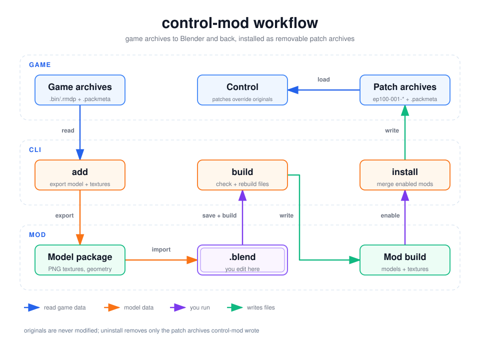

# control-mod — outfit & model modding for Control: Ultimate Edition

> [!WARNING]
> **This project was built by AI.** control-mod's code, tests and documentation were written by
> AI agents (Claude Opus 5.5) directed by RashKash103, and have not been fully reviewed by a human.
> The file formats were reverse engineered; what works in game was confirmed on one PC with the
> Steam version. It adds files to your game folder (it never changes the original ones), and a bad
> mod can crash the game: back up your saves (`control-mod backup-saves`), and verify everything
> yourself before you rely on it.

[](https://github.com/RashKash103/control-mod/actions/workflows/ci.yml)


`control-mod` lets you take any character model out of Control, edit it in Blender
(reshape and remodel meshes, add new pieces, re-weight, repaint textures, add new
materials and textures), turn it back into game files, and install it with a small mod
manager that can switch individual outfit mods on and off without touching the
original game files.

<picture>
  <source media="(prefers-color-scheme: dark)" srcset="docs/diagrams/workflow-dark.svg">
  <source media="(prefers-color-scheme: light)" srcset="docs/diagrams/workflow-light.svg">
  
</picture>

* Works for **any** model: everything is discovered by reading the game's archives —
  nothing is hard-coded per character. `control-mod find --characters` lists 180+
  character models (Jesse's 12 outfits, NPCs, enemies…).
* Original game files are never modified. Mods are installed as extra *patch archives*
  (`ep100-001-generic.bin/.rmdp/.packmeta`, …) that control-mod tags and can remove at any
  time; the generated `.packmeta` metadata tells the game about the changed files.
* All file formats were reverse engineered and are verified against **all 6,707
  models** in the game (byte-exact parse/re-serialise, `control-mod selftest`).
* It tells you when an edit reaches beyond your mod: textures shared with other
  models are flagged in Blender, in build reports and at install time.

## What the game accepts

Confirmed by in-game tests (November 2026, Steam version, ray tracing on):

| change | works? | notes |
|---|---|---|
| Repaint / recolour an existing texture | ✅ | keep its resolution; the build re-encodes it in the original format |
| Reshape, remodel, delete geometry; re-weight | ✅ | |
| Models larger than the original | ✅ | the generated metadata describes the new sizes |
| Add new parts using existing materials | ✅ | merged into the mesh that already uses that material |
| New materials (copies of existing ones) and extra meshes | ✅ | e.g. the [example mod](#6-example-mod-and-in-game-check)'s gold halo |
| Point a material at a different or brand-new texture | ✅ | a new texture must have the resolution of the texture it replaces |
| Change a texture's resolution | ❌ | refused at build time (its metadata describes the original size) |

How it works: next to every game archive is a `.packmeta` file with metadata the game
trusts over the files themselves — file sizes, vertex/index buffer sizes, bounding boxes,
each model's list of textures, texture layouts. control-mod writes that metadata for every
patch archive (`.packmeta` next to the patch), describing the modified and new files
(details in [docs/FORMATS.md](docs/FORMATS.md)). `control-mod build --size-matched` is a
fallback that needs no metadata: it keeps every file at its original size and allows
only in-place texture edits and geometry that fits.

---

## Contents

1. [Setup](#1-setup)
2. [Quick start](#2-quick-start)
3. [The workflow in detail](#3-the-workflow-in-detail)
4. [Editing in Blender — rules of the road](#4-editing-in-blender--rules-of-the-road)
5. [Shared textures: changes that reach other models](#5-shared-textures-changes-that-reach-other-models)
6. [Example mod and in-game check](#6-example-mod-and-in-game-check)
7. [The mod manager](#7-the-mod-manager)
8. [Sharing mods](#8-sharing-mods)
9. [Save game backups](#9-save-game-backups)
10. [Troubleshooting](#10-troubleshooting)
11. [Command reference](#11-command-reference)
12. [How it works / development](#12-how-it-works--development)

---

## 1. Setup

Requirements: Windows, [uv](https://docs.astral.sh/uv/), Blender 4.2+ (tested with
5.2), Control: Ultimate Edition (tested with the Steam version).

```bash
uv sync
```

```bash
uv run control-mod setup
```

`setup` auto-detects the game and Blender and writes `control-mod.toml`. If detection
fails, pass the paths explicitly:

```bash
uv run control-mod setup --game "C:\Program Files (x86)\Steam\steamapps\common\Control" --blender "C:\Program Files\Blender Foundation\Blender 5.2\blender.exe"
```

All commands below are run from this folder as `uv run control-mod …` (shortened to
`control-mod …` in the rest of this document). The first `add` or `build` also indexes which
models use which textures (about 30 seconds, cached until the game updates).

---

## 2. Quick start

A mod that changes Jesse's default **Bureau Casual** outfit (`jesse_civilian`):

```bash
uv run control-mod backup-saves
```

```bash
uv run control-mod find jesse --characters
```

```bash
uv run control-mod new my_casual --name "My casual outfit" --author "me"
```

```bash
uv run control-mod add my_casual jesse_civilian_publish_physx
```

```bash
uv run control-mod open my_casual
```

Edit in Blender, **save** (Ctrl+S), close Blender, then:

```bash
uv run control-mod build my_casual
```

```bash
uv run control-mod render my_casual --built
```

```bash
uv run control-mod install
```

Start the game and wear the outfit. To go back to the vanilla game at any time:

```bash
uv run control-mod uninstall
```

---

## 3. The workflow in detail

### 3.1 Find the model

```bash
uv run control-mod find jesse --characters
```

```bash
uv run control-mod info jesse_civilian_publish_physx --textures
```

```bash
uv run control-mod usage jesse_civilian_publish_physx --model
```

`find` accepts substrings or globs (`*civilian*`). `info` shows every mesh (per LOD),
its material and — with `--textures` — which texture file feeds each material slot.
`usage --model` shows which of the model's textures are shared with other models.

Jesse's outfits are `data/objects/characters/intermediate/jesse_<outfit>_publish_physx.binfbx`:

| file | outfit |
|---|---|
| `jesse_civilian` | Bureau Casual (default, confirmed) |
| `jesse_suit`, `jesse_suit_gold` | formal suits |
| `jesse_assistant`, `jesse_janitor`, `jesse_jumpsuit`, `jesse_tactical`, `jesse_urban`, `jesse_master`, `jesse_hedron`, `jesse_expedition`, `jesse_superhero` | other unlockable / DLC outfits |

(These are the game's internal names; `control-mod render` shows what each looks like.)

**Which model does the game actually use?** Some characters come in two versions, e.g.
`pope_default_publish` and `pope_default_publish_physx`. They're separate exports of the
same character (here: a different face rig and eye materials), and often only one of them
is placed in the game. `--used` shows how many level and effect files reference each
model, so you mod the right one (or both):

```bash
uv run control-mod find pope --used
```

```
pope_default_publish          5.83 MB  used by   4  data/objects/characters/intermediate/pope_default_publish.binfbx
pope_default_publish_physx    5.85 MB  unused       data/objects/characters/intermediate/pope_default_publish_physx.binfbx
```

`info <model> --used` names the files (`hub_npc_pope`, `hub_mission_01_the_bureau`, …) and
`find --unused` lists models nothing references. The first `--used` indexes the game
(about 75 seconds); later runs are instant until the game updates. "Unused" means no world
layer, type table or particle file references the model's resource id — almost
certainly unused, but not proven. When both versions are used (most of the 17 pairs,
e.g. the security guards), change both for the mod to show everywhere.

### 3.2 Create a mod and add models

```bash
uv run control-mod new red_casual
```

```bash
uv run control-mod add red_casual jesse_civilian_publish_physx
```

`add` extracts the model into `mods/red_casual/models/<model>/` and lists the textures
that other models share (see [section 5](#5-shared-textures-changes-that-reach-other-models)):

| file | what it is |
|---|---|
| `<model>.blend` | **the file you edit** |
| `textures/*.png` | every texture the model uses, decoded to PNG |
| `model.json`, `geometry.npz`, `template.binfbx` | the original data; don't edit |

A mod can contain several models (e.g. several outfits); run `add` once per model.

### 3.3 Edit

Open the `.blend` (`control-mod open red_casual`) and edit — see
[section 4](#4-editing-in-blender--rules-of-the-road) and the full
**[Blender guide](docs/BLENDER.md)**. Remember to **save** the `.blend` and any texture
you painted. The `.blend` contains a text block **`control-mod_READ_ME`** (Text Editor)
with the rules in short and the list of shared textures.

The 3D view's sidebar (N) has a **Control Mod** tab with tools: adopt imported models,
copy materials, new textures, save images, show one LOD, check for problems, and save &
build. Before building, check from the command line too:

```bash
uv run control-mod check red_casual
```

To bring in a model made elsewhere (glb, gltf, fbx, obj, blend), the `adopt` command
imports it and makes it game-ready — game-material copies with converted textures,
weights copied from the body, the game skeleton, a LOD collection:

```bash
uv run control-mod adopt red_casual jacket.glb
```

Place it on the character before exporting it from the other tool, or import it in
Blender, move it into place and use *Adopt selected* in the sidebar instead. Details:
[Bringing in outside models](docs/BLENDER.md#bringing-in-outside-models-glb-fbx-obj).

### 3.4 Build

```bash
uv run control-mod build red_casual
```

This runs Blender in the background to read your `.blend`, checks every change against
[what the game accepts](#what-the-game-accepts), and writes the game files into
`mods/red_casual/build/files/…` plus a `manifest.json`. A report tells you what
happened, e.g.:

```
texture added: data_pc/textures/control-mod/red_casual/.../jesse_civ_boots_gold_d.tex (from jesse_civ_boots_gold_d.png)
material added: jesse_civ_boots_gold (based on jesse_civ_boots)
texture modified: data_pc/textures/characters/andro/jesse/tops/jesse_civilian_tanktop_d.tex
47 of 48 meshes unchanged (original data kept)
WARNING: jesse_hands_d.tex is shared - this also changes 8 other model(s): jesse_hedron_publish_physx, ...
```

If an edit can't work in the game, the build stops and lists every problem with what to
do instead. Only files you actually changed end up in the mod. New textures go to
`data_pc/textures/control-mod/<mod>/<model>/`, so they never replace a game file.

`--size-matched` builds the fallback mode that needs no generated metadata: every file
keeps its original size (geometry has to fit the original buffers, LOD1 may borrow
LOD2's geometry to make room) and only in-place texture edits are allowed. Use it if
you install with another tool that can't ship `.packmeta` files.

### 3.5 Check

```bash
uv run control-mod render red_casual --built
```

```bash
uv run control-mod render red_casual --built --view face
```

```bash
uv run control-mod impact red_casual
```

`--built` re-imports the **built game file** (not your `.blend`) and renders it to
`mods/<mod>/renders/`, so you see what the game will get. Views: `front`, `back`,
`side`, `face`; `--lod N` renders a lower LOD. `impact` lists everything the mod
changes outside its own models.

### 3.6 Install, test, uninstall

```bash
uv run control-mod install
```

```bash
uv run control-mod status
```

```bash
uv run control-mod uninstall
```

Quit the game before installing or uninstalling (the game keeps archives open).

---

## 4. Editing in Blender — rules of the road

This is the summary; [docs/BLENDER.md](docs/BLENDER.md) covers every detail for Blender
artists (what the build does with geometry, normals, UVs, weights, materials, textures,
LODs and imported models).

The `.blend` contains:

* a collection named after the model, with sub-collections **`LOD0` … `LOD3`**
  (only LOD0 is visible by default),
* one object per game mesh (`LOD0_03_jesse_civ_jacket`, …), each with an Armature
  modifier,
* the skeleton (`<model>_skeleton`) — the game's bones, in Blender's Z-up space,
  facing −Y, left side on +X,
* one Blender material per game material, with image nodes for every texture slot
  (shared textures are **red** nodes labelled `SHARED xN`),
* the `control-mod_READ_ME` text block.

### 4.1 Meshes

* **Edit freely**: move/sculpt/remodel vertices, add or delete geometry, retopologise,
  change UVs, split or join objects. Modifiers are applied at build time (except the
  Armature modifier, which is ignored so the mesh is exported in rest pose).
* **Size**: the game's metadata records each model's file size, its vertex/index buffer
  sizes and bounding box, and allocates memory (including ray-tracing data) from those.
  The build writes new metadata for the rebuilt model, so models can grow. Meshes you
  didn't touch keep their original data. Added geometry still costs memory and frame
  time in every scene the character appears in — keep it reasonably light (a Decimate
  modifier helps). With `--size-matched` the total geometry must fit the original
  buffers instead (the build gives LOD1 LOD2's geometry to make room, and otherwise
  stops and tells you by how much).
* **The LOD comes from the collection** an object is in. An object outside any `LODn`
  collection counts as LOD0.
* **Mesh slots**: the game expects the original meshes to stay in place, grouped by LOD.
  control-mod takes care of it:
  * **new objects** using a material the LOD already has are merged into that mesh;
    objects with a new material (4.3) become extra meshes of their LOD. Give new parts
    bone weights (4.2). An object with several material slots is split per slot first;
  * **deleting** an original mesh's object leaves an invisible placeholder in its slot.
* Objects whose name starts with `_` are ignored (handy for reference/helper objects).
* Keep **UV map names** `UV0`, `UV1` (the first map is the one textures use).
* Normals: custom split normals are exported as you see them. Recalculating or
  "Smooth by Angle" are fine.
* Don't apply the object transform to the skeleton or move the armature object; moving
  mesh objects is fine (their transform is baked in).

### 4.2 Skinning (bone weights)

* Vertex groups named after **bones of the skeleton** are the bone weights. Bones can't
  be added, removed or renamed — the skeleton and all animations live in other game
  files. Groups that aren't bone names are ignored (with a warning).
* LOD0 of Jesse uses up to **8 influences per vertex**, LOD3 uses 4; extra influences
  are dropped (smallest first) and the rest renormalised automatically.
* Easiest ways to weight a new mesh:
  * *Data Transfer* modifier (Vertex Data → Vertex Groups, nearest face interpolated)
    from the body/clothing it sits on, or
  * parent it with *Armature Deform → With Automatic Weights*, or
  * for rigid accessories, assign everything to one bone (e.g. `C_head_JNT`) or parent
    the object to a bone (*Object → Parent → Bone*) — that also works without groups.
* Clothing that simulates in-game (Jesse's jacket tails, hair strands, straps) is driven
  by **cloth joints** (`…_cloth_JNT12`, `…hair…`). Weighting your new geometry to those
  joints makes it move with the simulation.
* Every vertex of a skinned model must have some weight; unweighted vertices are bound
  to the root bone and reported.

### 4.3 Materials and textures

You control **which material each face uses**, **which textures a material uses** and
**what the textures look like**:

* **Repaint a texture in place**: paint it in Blender (Texture Paint, then
  *Image → Save*) or edit `textures/<name>.png` in any image editor. Keep its
  **resolution**. The build re-encodes it in the original format (BC1/BC3/BC4/BC5/BC7)
  with the same mip count, so the file has exactly the original size.
* **Shared textures** (red `SHARED xN` nodes; image names start with `SHARED(N)_`):
  painting them changes every other model that uses them — see
  [section 5](#5-shared-textures-changes-that-reach-other-models).
* **Assign the model's existing materials** to new faces (material slots); new parts
  render with that material's textures (confirmed in game with the example mod's halo).
* **New textures**: point a material's image node at a new image (a new PNG next to the
  `.blend`, e.g. in `textures/`) — the build turns it into a new game texture used only
  by this model. It must have the **same resolution as the texture it replaces** (the
  new texture's metadata is copied from that one). Pointing at another texture of the
  model (an existing exported PNG) reuses that game texture.
* **New materials**: duplicate a material (the *New Material* button next to its name in
  the Material properties, or the sidebar's *Copy material*), rename it and assign it to
  faces. The copy keeps the original's shader
  and parameters; change its images as above. Good for making one piece look different
  without touching the rest of the outfit (the example mod's gold halo). Materials not
  copied from a game material (a fresh *New* material) are refused, since the game needs
  a shader it knows.
* **Not possible** (the build refuses with an explanation): resizing textures, and new
  textures with a different resolution than the one they replace.
* The preview material in Blender is an approximation (base colour × `g_vColorMultiplier`,
  normal map). The game's shaders also use smoothness/specular/detail/fuzz maps and
  parameters that Blender doesn't show — check the result in-game.

Texture slots you'll see most:

| slot | content | format |
|---|---|---|
| `g_sColorMap` | colour (+ alpha for hair/lashes) | BC1/BC3/BC7 |
| `g_sNormalMap` | tangent-space normal map; only R,G are stored (B is rebuilt) | BC5 |
| `g_sSmoothnessMap`, `g_sSpecularColorMap` | grey masks | BC4 |
| `g_sAlphaTestSampler` | alpha for alpha-tested materials | BC3 |
| `g_sBaseDetailMap` | tiling fabric detail (cloth shader) | BC5 |

Some colours come from material parameters, not textures: the formal suit's jacket uses
a tiny flat texture tinted by `g_vColorMultiplier`.

### 4.4 Material variants

Some models switch materials at runtime (`control-mod info` lists *material variants*,
e.g. Jesse Master's `frame`, NPCs' `hiss`). They are preserved automatically.

### 4.5 What can't be changed

The skeleton, animations, cloth simulation setup (`.binapx`), corrective-shape data
(`.rbf`), physics/ragdoll shapes and the material **shader code**. Big silhouette
changes may clip with animations or cloth, as in any game mod.

### 4.6 Levels of detail (LODs)

The game switches to LOD1–3 at distance. Choose per model (`control-mod add … --lods X`,
or `control-mod build <mod> --lods X` to change it):

| mode | LOD1+ come from | use when |
|---|---|---|
| `authored` *(default)* | the `LOD1`…`LOD3` collections, as in the `.blend` | texture-only mods, small edits, or you edit every LOD yourself |
| `decimate` | LOD0, automatically decimated to each original LOD's triangle ratio | geometry changes without hand-made LODs |
| `copy` | LOD0, copied | best quality at distance, heaviest (not with `--size-matched`) |

A LOD whose original uses materials LOD0 doesn't have (Jesse's LOD3 is one baked mesh)
keeps its original geometry in `decimate`/`copy` modes.

With `authored`, LODs you didn't touch keep the **original** look — fine for
texture-only mods, visible at distance if you changed LOD0's shape (then use
`decimate`, or edit the LOD collections too).

Replacing several meshes with one (say, torso and legs with one bodysuit) works: keep
both materials on the new mesh and each part lands in its original slot, or use one
material and delete the old objects (they become invisible placeholders). Do the same in
LOD1–3 or use `decimate`. See
[How objects become game meshes](docs/BLENDER.md#how-objects-become-game-meshes).

---

## 5. Shared textures: changes that reach other models

Many textures are used by more than one model — Jesse's face textures by all 12
outfits, `jesse_hands_d` by 9, fabric detail maps by dozens of models, and
`default*.tex` by hundreds. Repainting a shared texture changes **all** of them. control-mod
makes this visible at every step:

| where | what you see |
|---|---|
| `control-mod add` | a list of the model's shared textures and who else uses them |
| Blender | red image nodes `SHARED xN: g_sColorMap`, images named `SHARED(N)_…`, and the `control-mod_READ_ME` text |
| `control-mod build` | `WARNING: <texture> is shared - this also changes N other model(s): …` |
| `control-mod impact <mod>` | every file the mod changes, and every other model affected (`--all` for the full list); also edited-but-not-built textures |
| `control-mod install` | `note: '<mod>' edits shared textures - this also changes N other model(s)` |
| `control-mod usage <texture>` | which models use a texture (`--model <name>`: which textures of a model are shared) |

The usage index is built from the game files themselves (all 6,707 models) and is
rebuilt automatically after a game update. If a change to a shared texture is
intended (e.g. a new face for every outfit), there is nothing else to do; otherwise
pick a texture used only by your model (`control-mod usage <model> --model` marks those
"only this model").

---

## 6. Example mod and in-game check

Two example mods change the default **Bureau Casual** outfit (both confirmed in game;
enable one at a time, since they change the same model):

`mods/demo_new_assets` (default build mode):

| change | kind |
|---|---|
| **blue striped jacket** | brand-new texture for the jacket material |
| **gold halo** over the head | new object with a new material (a copy of the boots' material with a new gold texture), weighted to `C_head_JNT` |
| **red tank top** | texture repainted in place |

`mods/demo_civilian` (`--size-matched`, no metadata):

| change | kind |
|---|---|
| **red tank top** and **red jacket** | textures repainted in place (used only by this outfit) |
| **halo** over the head | new object using the boots' material (merged into the boots mesh); LOD1 reuses LOD2's geometry to make room |

To try one:

1. `control-mod backup-saves`
2. Close the game, then `control-mod install`.
3. Start the game (Jesse wears Bureau Casual by default).
4. `control-mod uninstall` (game closed) restores the vanilla game.

In a fresh clone the extracted model isn't in git. Recreate a mod with
`control-mod add <mod> jesse_civilian_publish_physx --force`, run
[`examples/demo_edit.py`](examples/demo_edit.py) on the `.blend`, then build:

| mod | `demo_edit.py` options | build |
|---|---|---|
| `demo_new_assets` | `--halo jesse_civ_boots --halo-copy jesse_civ_boots gold --new-texture jesse_civ_jacket blue --recolor-png <tank top png>` | `control-mod build demo_new_assets` |
| `demo_civilian` | `--halo jesse_civ_boots --recolor-png <tank top png> --recolor-png <jacket png>` | `control-mod build demo_civilian --size-matched` |

The script also shows how to script Blender edits.

If nothing changes in-game: make sure the game was closed while installing, check
`control-mod status`, try another patch slot (`control-mod setup --patch-number 2` then
`control-mod install`), and see [Troubleshooting](#10-troubleshooting).

---

## 7. The mod manager

Control loads every `*.rmdp` archive in `data_packfiles`, and an archive named
`ep100-001-generic` overrides files of `ep100-000-generic` (same for `-pc`, `ep101-…`,
etc.). One archive per mod would collide as soon as two mods touch the same original
archive — and all outfits live in the same one. So control-mod **merges all enabled mods
into one patch per original archive**, rebuilt on every `install`, together with the
`.packmeta` metadata for each patch.

```bash
uv run control-mod list
```

```bash
uv run control-mod disable red_casual
```

```bash
uv run control-mod order red_casual 1
```

```bash
uv run control-mod install
```

* **Per-outfit control**: each outfit is a separate model file, so a mod that only
  contains `jesse_civilian` leaves every other outfit alone — unless it repaints shared
  textures, which `install` and `impact` point out. Put outfits in separate mods if you
  want to toggle them separately.
* **Removing a mod**: `control-mod remove <mod>` deletes `mods/<mod>/` (its `.blend`
  files, textures and builds). If the mod is installed, the patch archives are rebuilt
  without it first (close the game). It asks for confirmation; `--yes` skips that.
* **Load order**: if two enabled mods change the same file, the one later in
  `control-mod list` wins and `install`/`status` report the conflict.
* **Safety**: archives written by control-mod carry a marker; `uninstall` deletes only those.
  If another (non-control-mod) mod already uses patch slot 001, control-mod moves to 002.
* **After a game update**: rebuild your mods (`control-mod build <mod>`) and `control-mod install`
  again — metadata and textures come from the current game files.
* **Loose files**: `control-mod export-loose <folder>` writes the merged files as a folder
  tree, for use with a loose-file loader instead of patch archives. Loose files carry no
  metadata, so build such mods with `--size-matched`.

---

## 8. Sharing mods

```bash
uv run control-mod pack red_casual
```

```bash
uv run control-mod unpack dist\red_casual-1.0.0.zip
```

`pack` zips `mod.toml` + the built files into `dist/`; `--sources` also includes the
`.blend` and model package so others can keep editing. The receiver runs `unpack` and
`install`. Edit `name`, `author`, `version`, `description` in `mods/<id>/mod.toml`.
Note that packed mods contain (modified) game assets — share responsibly.

---

## 9. Save game backups

```bash
uv run control-mod backup-saves
```

Copies your saves (Steam: `Steam\userdata\<id>\870780`; Epic/GOG:
`%LOCALAPPDATA%\Remedy\Control`) into `backups/saves-<timestamp>/` (git-ignored). To
restore, quit the game, pause Steam Cloud, and copy the files back.

---

## 10. Troubleshooting

| problem | fix |
|---|---|
| `Blender not found` / `Game directory not configured` | `control-mod setup --blender … --game …` |
| `matches N models; be more specific` | use the exact name from `control-mod find` |
| build: `… cannot work in the game: …` | each listed item says what to do instead (section 4.3) |
| build: `… larger than the original even with the simplest LODs` (`--size-matched`) | lighten or remove added geometry, or build without `--size-matched` (4.1) |
| build: `mesh '…' has no vertex groups` | weight the mesh (4.2) or parent it to a bone |
| build: `material '…' is not a game material` | copy one of the model's materials instead of creating a new one (4.3) |
| build: new image `…` has a different resolution | resize the image to the replaced texture's size (4.3) |
| build: `no LOD0 meshes found` | keep meshes in the `LOD0` collection |
| game crashes at startup or while loading a save | `control-mod uninstall`; if the mod was built with `--experimental`, rebuild without it; check that the `.packmeta` next to the patch was installed |
| model looks fine close up but wrong far away | stale LODs with `authored` → `--lods decimate`, or edit LOD1–3 |
| textures look washed out / wrong in Blender | Blender preview ≠ game shader; normal/mask maps are Non-Color |
| `add --force` lost my edits | `--force` re-exports from the game; keep backups of your `.blend` |
| build: `Blender material '…' is not linked to a game material` | imported or *New* material: run *Adopt selected* / `control-mod adopt`, or use a duplicate of a game material |
| build: `image … is packed or not saved to a file` | sidebar > *Save images* |
| no **Control Mod** tab in Blender | open with `control-mod open`, or allow scripts / run the `control_mod_tools.py` text block |
| Blender failed: … | the error tail is printed; run the shown Blender command yourself to see the full log |

When the game crashes, Windows logs where: *Event Viewer → Windows Logs →
Application*, "Application Error" for `Control_DX12.exe`. A crash in
`rl_rmdwin10_f.dll` at offset `0x1c08e0` means a file didn't match the game's
metadata (usually a model that grew); one in `renderer_rmdwin10_f.dll` at `0xa866b`
(ray-tracing setup) means a model's buffers or mesh list no longer matched the
original's metadata.

---

## 11. Command reference

| command | purpose |
|---|---|
| `setup [--game] [--blender] [--patch-number]` | configure paths |
| `find [pattern] [--characters] [--files] [--used] [--unused]` | search models / files; `--used` shows which models the game references |
| `info <model> [--textures] [--used]` | meshes, materials, textures of a model; `--used` lists the files that use it |
| `usage <texture>` / `usage <model> --model` | who uses a texture / which of a model's textures are shared |
| `extract <glob> [-o dir] [--png]` | dump raw game files (textures as PNG) |
| `new <mod>` | create a mod project |
| `add <mod> <model> [--lods] [--force]` | extract a model and create its `.blend` |
| `open <mod> [model]` | open the `.blend` in Blender (with the Control Mod sidebar tools) |
| `adopt <mod> <file> [--model] [--material] [--lod] [--weights] [--bone] [--flip-green]` | import a glb/gltf/fbx/obj/blend into the mod's `.blend` and make it game-ready |
| `check <mod> [model]` | list what the build would refuse (and likely problems) in the `.blend` files |
| `build <mod> [--lods] [--install] [--size-matched] [--experimental]` | `.blend` → game files (checked against what the game accepts) |
| `render <mod> [model] [--built] [--view] [--lod]` | preview image |
| `impact <mod> [--all]` | what the mod changes outside its own models |
| `list`, `enable`, `disable`, `order` | mod manager |
| `remove <mod> [--yes]` | delete a mod (uninstalls it first if installed) |
| `install [--dry-run] [--metadata]`, `uninstall`, `status` | apply / remove mods (`--metadata` writes `.packmeta` even when only size-matched mods are enabled) |
| `export-loose <dir>` | merged files as folders |
| `pack <mod> [--sources]`, `unpack <zip>` | share mods |
| `backup-saves` | back up save games |
| `selftest [pattern]` | verify the parser against every game model |

---

## 12. How it works / development

```
src/control_mod/
  archive.py     .bin/.rmdp archives (read/write)
  binfbx.py      .binfbx model files (lossless parse/serialise)
  geometry.py    vertex/index buffer decode/encode
  model.py       rebuild a .binfbx from edited meshes (or fit it to the original size)
  packmeta.py    .packmeta archive metadata (read/write)
  texture.py     .tex (DDS) <-> images, BC1/3/4/5/7
  package.py     game <-> Blender conversion, model packages, checked build from Blender
  usage.py       game-wide index of which models use which textures
  gamedata.py    all game archives as one file system
  project.py     mod projects, Blender driver
  installer.py   mod manager, patch archives and their metadata
  cli.py         command line
  blender/ctl_blender.py   runs inside Blender (import/export/render)
  blender/control_mod_tools.py   Blender sidebar tools: adopt, check, materials, textures
examples/demo_edit.py      scripted Blender edits (halo, new material/texture, recolour)
docs/BLENDER.md            guide for Blender artists
docs/FORMATS.md            file format notes
docs/diagrams/             diagram sources (fireworks-tech-graph)
tests/                     pytest suite
```

Tests:

```bash
uv run pytest
```

Synthetic tests always run; tests needing the game or Blender skip automatically when
those aren't found (`CONTROL_MOD_GAME_DIR`, `CONTROL_MOD_BLENDER` override detection). Set
`CONTROL_MOD_FULL_SCAN=1` to round-trip every game model instead of only characters.

GitHub Actions run the tests on Windows and Linux for every push to `main` and every
pull request (game/Blender tests skip there, so also run `uv run pytest` locally with
both installed before releasing).

Releasing: *Actions → Release → Run workflow* with a version (e.g. `0.2.0`) bumps
`pyproject.toml`, tags `v0.2.0`, and publishes a GitHub release with the wheel and
sdist. Pushing a `v*` tag that matches the version in `pyproject.toml` does the same.

File format details are in [docs/FORMATS.md](docs/FORMATS.md).

## License

control-mod is released under the [MIT License](LICENSE). It contains no game files; Control
and its assets belong to Remedy Entertainment, and mods you build contain (modified) game
assets.
